# grails-scim Plugin Design

Version: 7.0.0-M4. Applies to Grails 7.0.x, Spring Boot 3.5, Java 17.

This document describes how the plugin is put together and how a request travels through it. Diagrams are written in Mermaid and render directly on GitHub. For the authentication rationale and the decisions behind it see [MULTI_TENANT_TOKEN_DESIGN.md](MULTI_TENANT_TOKEN_DESIGN.md); for the wire contract see [API_USAGE.md](API_USAGE.md).

## 1. Purpose and boundaries

The plugin exposes SCIM 2.0 endpoints for User and Group provisioning and nothing else. It owns authentication, request parsing, response shaping and error mapping. It does **not** own storage: every read and write is delegated to two beans the host application provides, `scimUserRepository` and `scimGroupRepository`, both implementing `ScimResourceRepository<T>`.

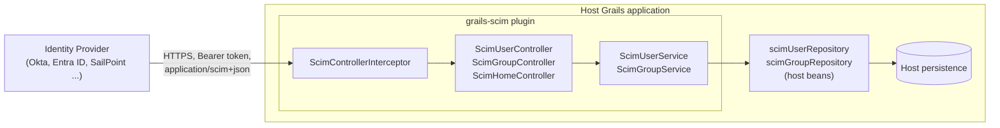

Everything inside the plugin box ships in the jar. Everything outside is the host's responsibility.

## 2. Component map

```mermaid
flowchart TB
    subgraph grails-app
        INT[ScimControllerInterceptor]
        UC[ScimUserController]
        GC[ScimGroupController]
        HC[ScimHomeController]
        US[ScimUserService]
        GS[ScimGroupService]
        BS["BootStrap<br/>(JSON marshaller)"]
    end

    subgraph security["src/main/groovy/.../security"]
        TP[ScimTenantTokenParser]
        JP[ScimJwtParser]
        KR[ScimTenantKeyResolver]
        CKR[ConfigScimTenantKeyResolver]
        JR[ScimTenantJwtSecretResolver]
        CJR[ConfigScimTenantJwtSecretResolver]
        CTX[ScimTenantContext]
    end

    subgraph resources["src/main/groovy/.../resources"]
        SU[ScimUser]
        SG[ScimGroup]
        PR[PatchRequest / Operation]
        EXT["CustomUserExtension<br/>CustomGroupExtension"]
    end

    subgraph binding["src/main/groovy/.../binding"]
        DBS[JsonScimApiDataBindingSourceCreator]
        REG[DataBindingSourceRegistryUpdater]
    end

    PLUG[GrailsScimGrailsPlugin]
    REPO["ScimResourceRepository&lt;T&gt;<br/>(interface, host implements)"]

    INT --> TP & JP & KR & JR & CTX
    CKR -. implements .-> KR
    CJR -. implements .-> JR
    UC & GC --> CTX
    UC --> SU & PR & EXT
    GC --> SG & PR & EXT
    UC --> US --> REPO
    GC --> GS --> REPO
    BS --> SU & SG
    PLUG -- "doWithSpring registers" --> DBS & REG & CKR & CJR
    REG --> DBS
```

| Layer | Responsibility |
|---|---|
| Interceptor | Enable switch, authentication, tenant context lifecycle |
| Controllers | Bind SCIM JSON into resource objects, apply tenant rules, map exceptions to SCIM errors, render `application/scim+json` |
| Services | Thin `@ReadOnly` pass-through to host repositories; translate `attributes` into `excludedAttributes` |
| Security package | Token parsing, signature and hash verification, secret resolution, request-scoped tenant holder |
| Resources | Plain `Validateable` POJOs mirroring SCIM core schema plus the custom tenant extension |
| Binding | Teaches Grails to treat `application/scim+json` as JSON so `request.JSON` works |
| BootStrap | Custom JSON marshaller that emits the tenant extension under its URN and hides internal fields |

## 3. Startup

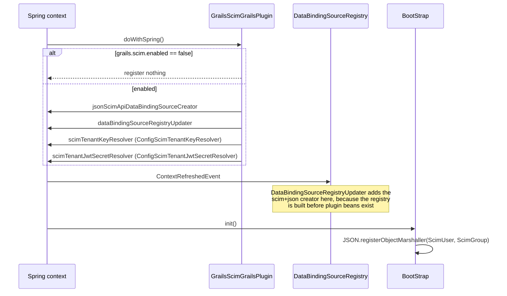

Both resolver beans are registered by name. A host that declares its own `scimTenantKeyResolver` or `scimTenantJwtSecretResolver` bean in `resources.groovy` replaces the default without touching the plugin.

## 4. Request lifecycle

Every call to a `scimHome`, `scimUser` or `scimGroup` action follows the same path.

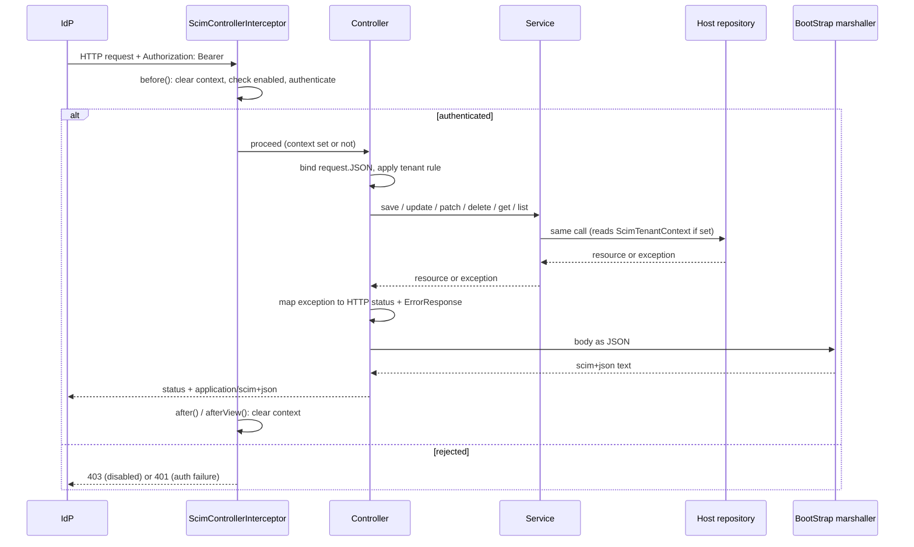

The tenant context is cleared at the start of `before()` and again in `after()` and `afterView()`, so a Tomcat worker thread can never carry a tenant from one request into the next.

## 5. Authentication decision flow

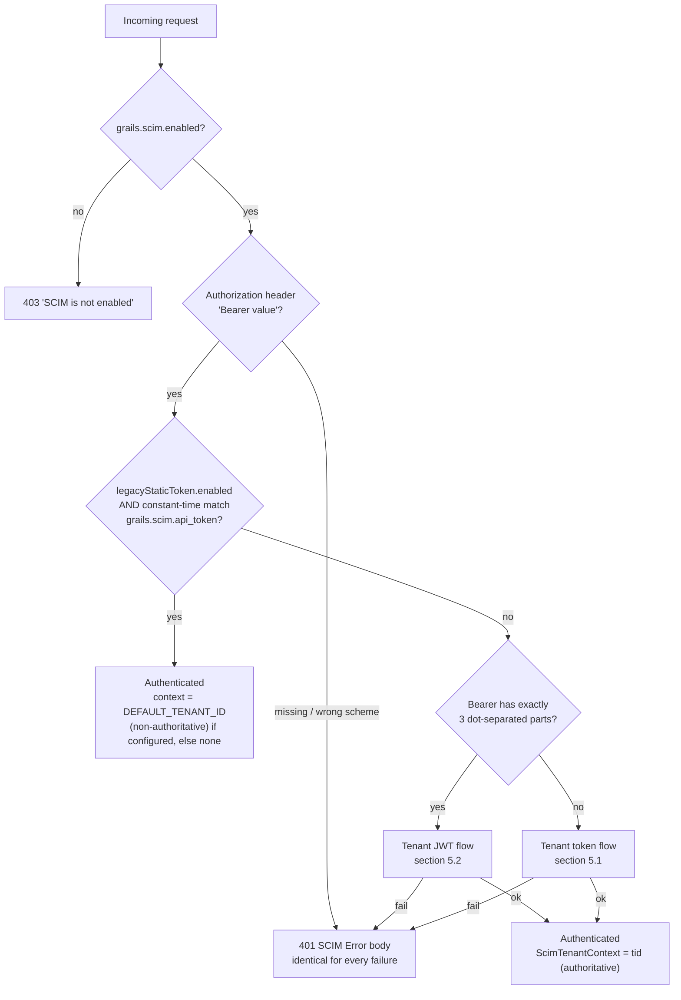

The three flows are mutually exclusive per request and tried strictly in this order. The legacy check runs first because it is the cheapest and because the static secret can never look like either tenant format.

### 5.1 Tenant token flow

Token shape: `base64url(tenantId).base64url(secret)`.

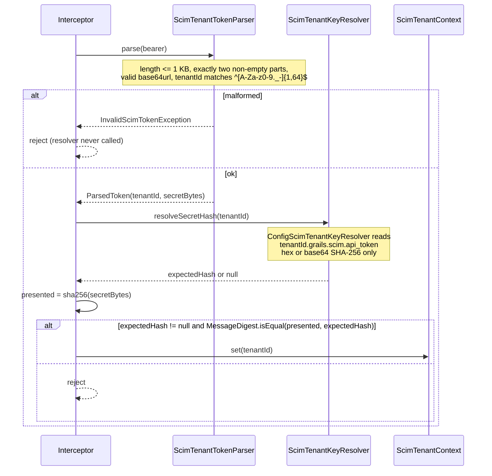

Only the hash is stored server-side. A configuration leak does not yield a usable token.

### 5.2 Tenant JWT flow

Token shape: standard HS256 JWS, header carries `tid` and `kid`.

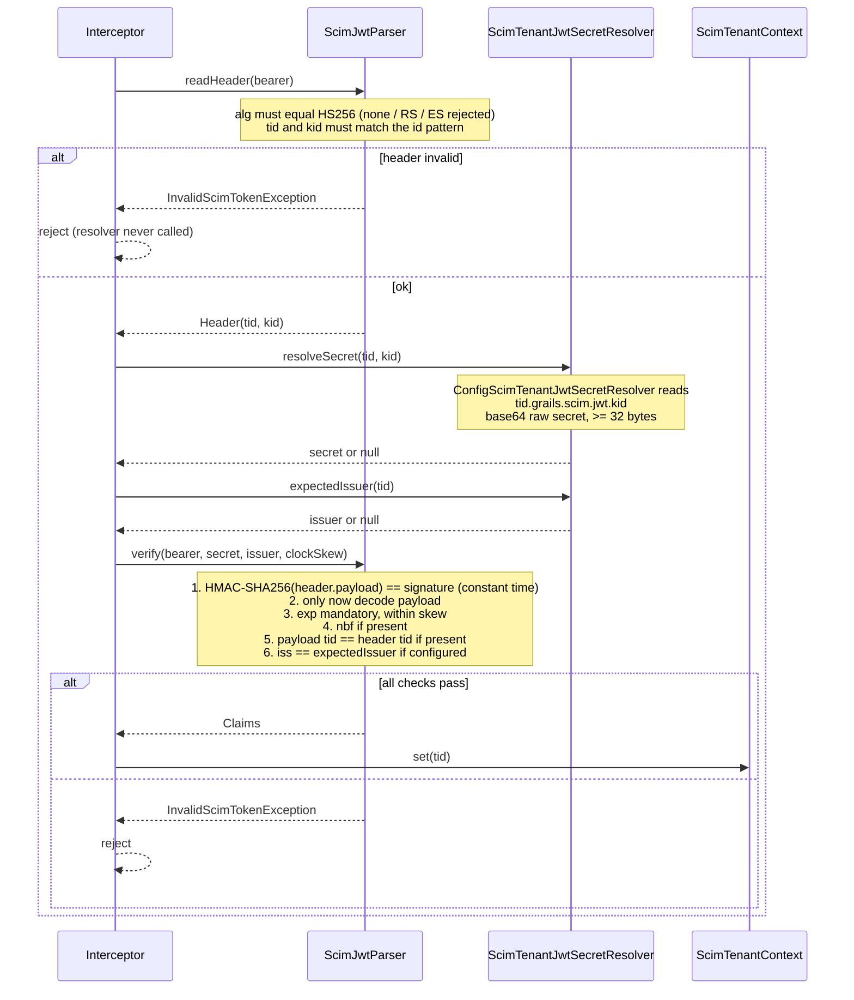

The header is covered by the signature, so `tid` and `kid` can be read before verification to find the key and trusted after it. The payload is never decoded before the signature has been checked.

### 5.3 What each flow leaves behind

| | Legacy static token | Tenant token | Tenant JWT |
|---|---|---|---|
| `ScimTenantContext` | `DEFAULT_TENANT_ID` if configured (non-authoritative), else not set | `tenantId` (authoritative) | `tid` (authoritative) |
| Server-side secret | plaintext `grails.scim.api_token` | SHA-256 hash only | raw HMAC secret |
| Expiry | none | none | `exp` mandatory |
| Rotation | replace the value | replace the hash | add new `kid`, retire old |
| Payload tenant fields | honoured as sent | ignored, extension left null | ignored, extension left null |

## 6. Tenant handling in controllers

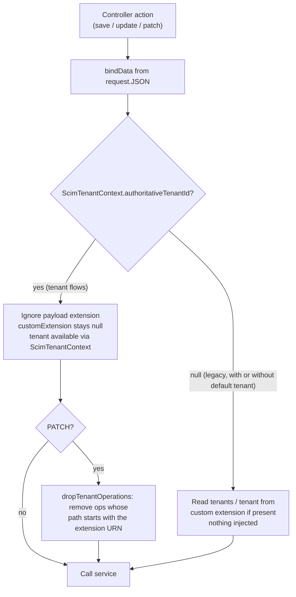

A legacy request with `DEFAULT_TENANT_ID` configured still takes the left branch: the context exists for repositories (`currentTenantId()`), but it is not authoritative, so payload tenants are neither replaced nor injected.

The rule is deliberately "ignore", not "reject". An IdP that sends a static extension block keeps working, and the repository can never receive a tenant other than the authenticated one because the only tenant source in these flows is `ScimTenantContext.currentTenantId()`.

## 7. Data binding and serialisation

**Inbound.** Grails only parses `request.JSON` for mime types it knows as JSON. `JsonScimApiDataBindingSourceCreator` registers `application/scim+json` (and the UTF-8 variant, or whatever `grails.scim.mime.types` lists). `DataBindingSourceRegistryUpdater` adds it on `ContextRefreshedEvent` because the registry is already built when plugin beans are created.

**Outbound.** `BootStrap` registers one closure marshaller for `ScimUser` and `ScimGroup`:

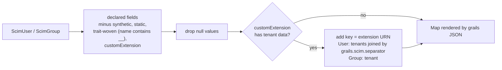

The trait filter matters: `Validateable` weaves fields such as `grails_validation_Validateable__constraintsMapInternal` into the class. They are not synthetic, and once `validate()` has been called they hold objects the JSON converter cannot serialise. Any new resource field must be a plain, non-static declared field to appear in output.

## 8. Error mapping

Controllers catch repository exceptions and translate them. The body is always `ErrorResponse` rendered as `application/scim+json` with the SCIM error schema.

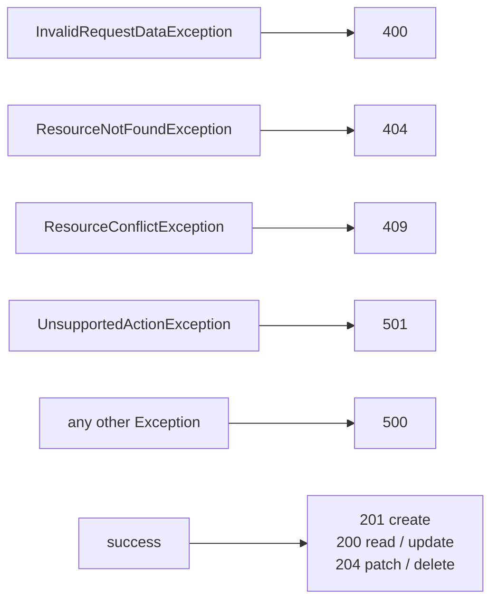

`PUT /Users/{id}` and `PUT /Groups/{id}` additionally require the body `id` to equal the path `id`; a mismatch is a 400 before the repository is called. Authentication failures never reach this table; they are answered by the interceptor with a 401 whose body is the same for every cause.

## 9. Discovery endpoints

`ScimHomeController` serves the SCIM discovery documents with no repository involvement.

| Path | Source |
|---|---|
| `/Schemas`, `/Schemas/{id}` | `src/main/resources/schemas.json`, `meta.location` rewritten to the request base URL |
| `/ResourceTypes`, `/ResourceTypes/{id}` | Built in code for User and Group with the custom extension declared |
| `/ServiceProviderConfig` | Built in code; advertises `bearertoken`, patch and filter support |
| `/docs/scim-auth` | `src/main/resources/docs/scim-auth.html` with `{{BASE_URL}}` substituted, or JSON when `Accept: application/json` |

Base URL honours `X-Forwarded-Proto` and `X-Forwarded-Host`, so the documents are correct behind a reverse proxy.

## 10. Extension points for the host

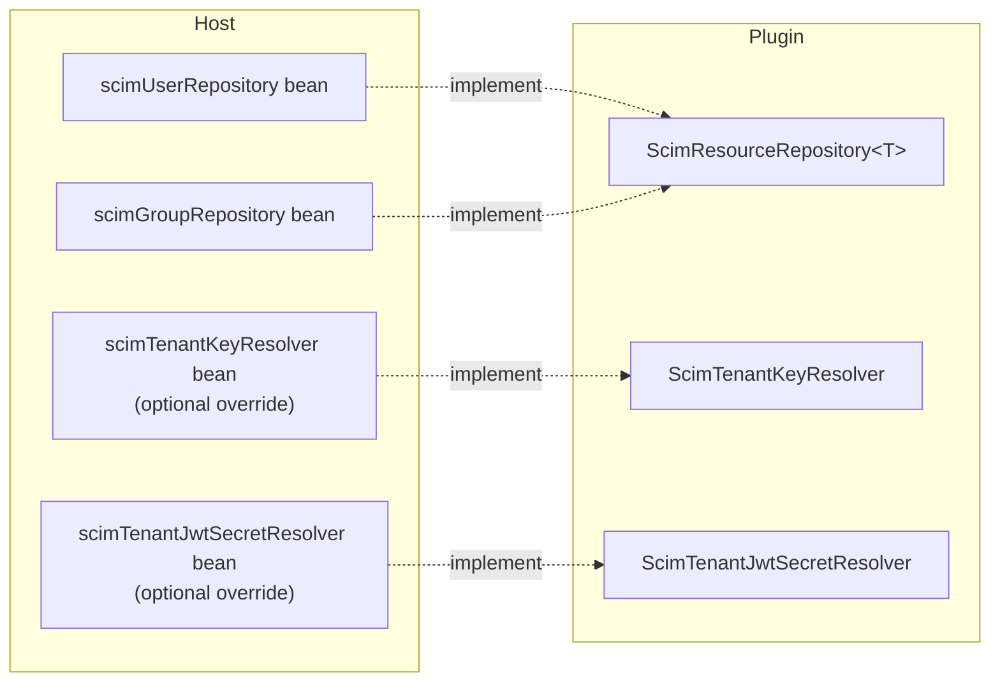

| Extension point | Mandatory | Contract |
|---|---|---|
| `scimUserRepository`, `scimGroupRepository` | yes | Implement `get`, `save`, `update`, `patch`, `delete`, `findAll`. When `ScimTenantContext.currentTenantId()` is non-null, scope every operation to it and throw `ResourceNotFoundException` for ids belonging to another tenant. When null, behave as a single-tenant store. |
| `scimTenantKeyResolver` | no | Return the SHA-256 digest of a tenant's secret, or null. Never throw for unknown tenants. |
| `scimTenantJwtSecretResolver` | no | Return the raw HMAC secret for a tenant and key id, or null, plus an optional expected issuer. Never throw for unknown tenants. |

### 10.1 Overriding `scimTenantJwtSecretResolver`

The default `ConfigScimTenantJwtSecretResolver` reads secrets from configuration keys. A host application can replace it with its own behaviour, for example loading secrets from a tenant table, a secrets vault, or a cache with time-based refresh, and enforcing extra rules such as per-tenant issuer lists or disabled tenants. The plugin registers the default bean under the name `scimTenantJwtSecretResolver`; a host bean with the same name declared in `grails-app/conf/spring/resources.groovy` wins, because application beans override plugin beans in Grails.

```groovy
// grails-app/conf/spring/resources.groovy in the host application
beans = {
    scimTenantJwtSecretResolver(com.example.scim.VaultScimTenantJwtSecretResolver) {
        vaultClient = ref('vaultClient')
        tenantService = ref('tenantService')
    }
}
```

```groovy
package com.example.scim

import grails.plugins.scim.security.ScimTenantJwtSecretResolver
import groovy.transform.CompileStatic

@CompileStatic
class VaultScimTenantJwtSecretResolver implements ScimTenantJwtSecretResolver {

    VaultClient vaultClient
    TenantService tenantService

    @Override
    byte[] resolveSecret(String tenantId, String kid) {
        if (!tenantService.isActive(tenantId)) {
            return null                                   // disabled tenant: uniform 401
        }
        String base64 = vaultClient.read("scim/${tenantId}/jwt/${kid}")
        byte[] secret = base64 ? Base64.decoder.decode(base64) : null
        return (secret != null && secret.length >= 32) ? secret : null
    }

    @Override
    String expectedIssuer(String tenantId) {
        tenantService.scimIssuerFor(tenantId)             // null means not enforced
    }
}
```

Contract for a custom resolver:

- `tenantId` and `kid` arrive already validated against `^[A-Za-z0-9._-]{1,64}$`, so they are safe to use in lookups, but they must still be treated as untrusted when building external paths or queries.
- Return `null` for an unknown or disabled tenant or key. Never throw; an exception would change the failure shape and break the uniform 401.
- Return the raw secret bytes, at least 32 of them. The parser rejects shorter keys.
- Do not log the secret. Logging the tenant id and key id at debug level is fine.
- Cache if the backing store is slow, but keep the TTL short so revocation takes effect promptly.

The same override pattern applies to `scimTenantKeyResolver` for the two-part tenant token, with `resolveSecretHash(tenantId)` returning the SHA-256 digest instead of a raw secret.

The plugin also exposes `ScimTenantTokenParser.build`, `ScimTenantTokenParser.sha256Hex` and `ScimJwtParser.sign` for administrator tooling, so token formats are produced in exactly one place.

## 11. Configuration reference

| Key | Default | Purpose |
|---|---|---|
| `grails.scim.enabled` | false | Master switch for beans and interceptor |
| `grails.scim.api_token` | none | Legacy static bearer token |
| `grails.scim.legacyStaticToken.enabled` | true | Set false to accept tenant credentials only |
| `DEFAULT_TENANT_ID` | none | Tenant placed in `ScimTenantContext` as a non-authoritative default for legacy requests |
| `<tenantId>.grails.scim.api_token` | none | SHA-256 (hex or base64) of the tenant token secret |
| `<tenantId>.grails.scim.jwt.<kid>` | none | Base64 raw HMAC secret, at least 32 bytes; `issuer` is reserved |
| `<tenantId>.grails.scim.jwt.issuer` | none | When set, the JWT `iss` claim must match |
| `grails.scim.jwt.clockSkewSeconds` | 60 | Tolerance for `exp` and `nbf` |
| `grails.scim.separator` | `,` | Delimiter for the `tenants` extension string |
| `grails.scim.mime.types` | scim+json variants | Override the mime types treated as SCIM JSON |

Secrets and hashes belong in environment variables or a vault, never in committed configuration. JWT secrets in particular are stored raw because HMAC verification needs the key bytes.

## 12. Security properties

- **Constant-time comparison** for the legacy token, the tenant token hash and the JWT signature, via `MessageDigest.isEqual`.
- **Algorithm pinning.** The JWT header `alg` is compared for equality with `HS256`; it is never used to choose an algorithm.
- **Verify before parse.** The JWT payload is not decoded until the signature has been checked.
- **Uniform failure.** Unknown tenant, unknown key, wrong secret, malformed token and expired token all produce the same 401 body and the same log shape, so nothing can be enumerated.
- **No credential logging.** The Authorization header is never written to the log; failures log the client IP and a reason code only.
- **Input bounds before work.** Length limits, part counts, base64 validity and id patterns are enforced before any lookup or cryptographic operation.
- **Tenant isolation in two places.** Controllers discard payload tenants in tenant flows so the resource carries none; repositories scope by the context. Both are required.
- **No master key.** Each tenant has its own secret or hash. A leaked credential or a leaked server-side value affects one tenant only.
- **Thread safety.** `ScimTenantContext` is a ThreadLocal cleared on entry and on both exit paths of the interceptor.

## 13. Testing approach

Specs live under `src/test/groovy/grails/plugins/scim/` with security classes under `security/`. Controllers and the interceptor are tested with `ControllerUnitTest` and `InterceptorUnitTest`; services and resolvers are Spock mocks assigned directly. Response bodies are asserted by parsing `response.text`. There is no GORM or database, so no integration layer is needed. Any spec that touches tenant behaviour clears `ScimTenantContext` in `setup` and `cleanup`.

| Area | Spec | What it proves |
|---|---|---|
| Token format | `ScimTenantTokenParserSpec` | Round trip, every malformed shape rejected before lookup |
| JWT | `ScimJwtParserSpec` | Algorithm pinning, tampered header and payload, claim rules, skew |
| Resolvers | `ConfigScimTenantKeyResolverSpec`, `ConfigScimTenantJwtSecretResolverSpec` | Config key shape, hash-only and length rules, no lookup for invalid ids |
| Context | `ScimTenantContextSpec` | Set, clear, thread isolation |
| Interceptor | `ScimControllerInterceptorSpec` | All three flows, flag on and off, every failure mode, context lifecycle |
| Controllers | `ScimUserControllerSpec`, `ScimGroupControllerSpec` | Payload tenant ignored in tenant flows, PATCH op dropping, legacy and default-tenant pass-through, status mapping |
| Serialisation | `ScimResponseMarshallerSpec` | Trait fields and statics excluded, extension emitted under its URN |
| Discovery | `ScimHomeControllerSpec` | Schema, resource type, provider config and auth page rendering |
